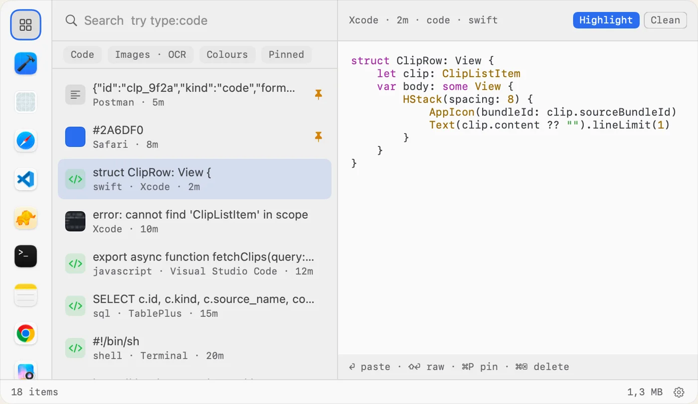
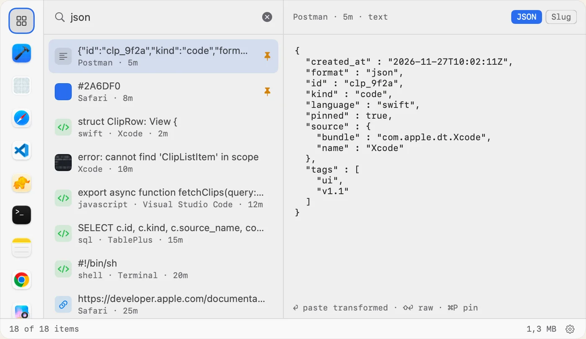
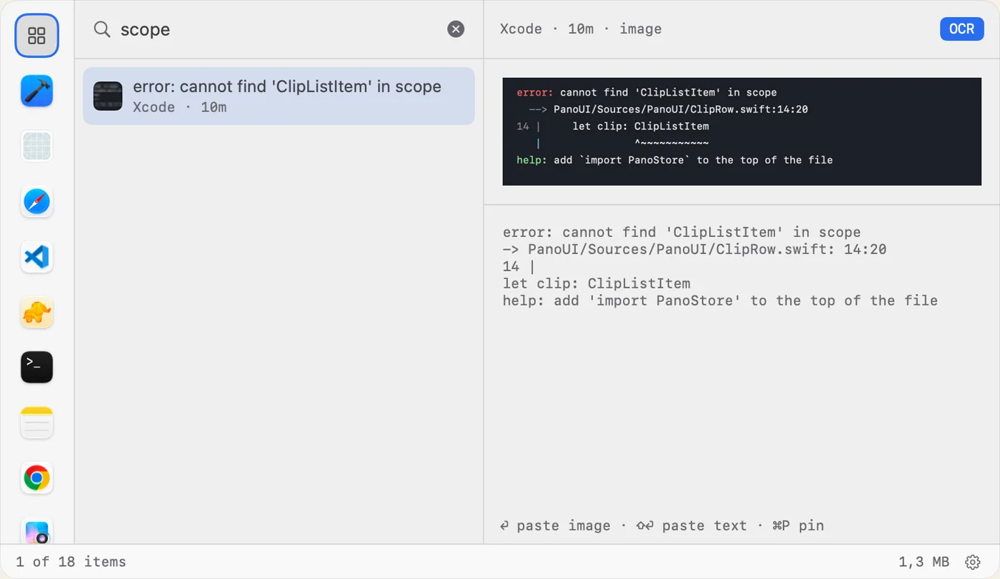
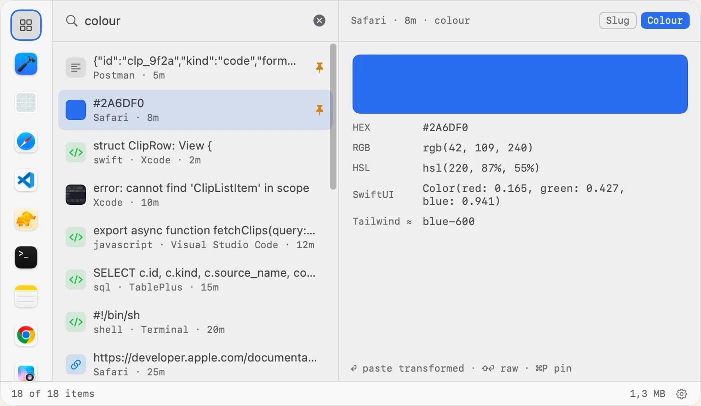
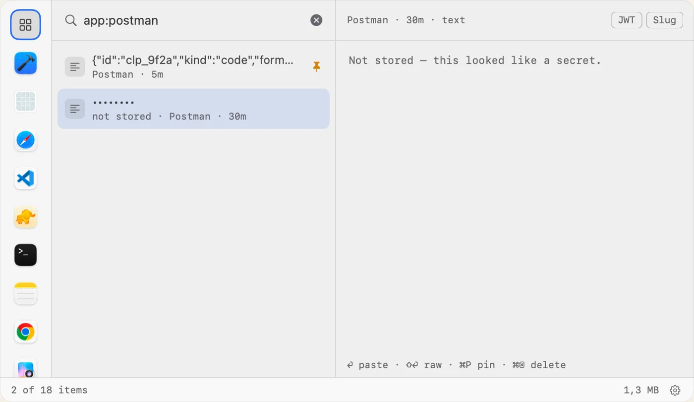

<div align="center">


# Pano

### Clipboard history for Mac, built for the way you work.

A free, open-source, strictly local clipboard manager for macOS. Unlimited SQLite FTS5 history, live JSON/JWT/Base64/Tailwind transforms, and on-device screenshot OCR, with zero subscriptions and zero clipboard network calls.

**[Download DMG (Auto-Paste)](https://github.com/theshiver/pano-app/releases/latest)** · [Mac App Store (Sandboxed)](https://apps.apple.com/app/id6812981549) · [Website](https://pano-app.com) · [☕ Buy me a coffee](https://buymeacoffee.com/cancetin) · [Changelog](CHANGELOG.md)

<sub>Free forever · MIT Open Source · Zero network access · Zero telemetry · macOS 15.4+</sub>

<br>

<picture>
  <source media="(prefers-color-scheme: dark)" srcset="docs/assets/hero-dark.webp">
  <source media="(prefers-color-scheme: light)" srcset="docs/assets/hero-light.webp">
  
</picture>

</div>

## Install

```bash
brew install --cask theshiver/tap/pano
```

Choose the free build that fits your workflow:

| Build | How to install | Paste behaviour |
|---|---|---|
| **Direct DMG / Homebrew** (`PanoDirect`) | Download `Pano-1.1.1.dmg` from [GitHub Releases](https://github.com/theshiver/pano-app/releases/latest) or run `brew install --cask theshiver/tap/pano` | Includes optional Auto-Paste (`Return` presses `⌘V` once Accessibility is granted) and optional in-app GitHub Releases update checks. See the [Auto-Paste setup guide](https://pano-app.com/auto-paste-setup/). |
| **Mac App Store** (`Pano`) | Install from the [Mac App Store](https://apps.apple.com/app/id6812981549) | Strictly sandboxed, copy-only (`Return` puts the clip on your clipboard, you press `⌘V`), with zero Accessibility or synthetic-event APIs. |

## Features

| | |
|---|---|
| **Unlimited Searchable History (SQLite FTS5)**<br>Instant full-text search, quick-filter chips (`Code`, `Images · OCR`, `Colours`, `Pinned`), and filter tokens (`type:`, `app:`, `pinned:`, `>7d`). | **Live Transforms as You Type**<br>Type `json`, `b64`, `jwt`, `slug`, `url`, `clean`, or `markdown` in the search bar to preview the converted result live. Press `⏎` to paste the converted value or `⇧⏎` for the original. |
| **On-Device Screenshot OCR**<br>Apple Vision indexes text inside copied screenshots locally. Search words inside images and paste only the extracted text with `⇧⏎`. ([Screenshot OCR guide](https://pano-app.com/ocr-clipboard-mac/)) | **Colour Swatches & Tailwind**<br>Copy a hex colour to preview a live swatch alongside `rgb()`, `hsl()`, SwiftUI `Color`, and the nearest Tailwind utility class. |
| **Source-App Rail & Pinboards**<br>Filter by the app you copied from, pin recurring clips so they never expire, organize clips into pinboards, drag items out, and resize the panel. | **Privacy-First Retention**<br>Concealed password-manager copies never touch disk. API keys, JWTs, card numbers, and IBANs are masked and expire on a short timer. Separate text, image, and secret retention rules, plus quick-clear (last 15m / 1h) and Pause capture from the menu bar. |

## Inside Pano

<table>
  <tr>
    <td width="50%" valign="top">
      <picture>
        <source media="(prefers-color-scheme: dark)" srcset="docs/assets/transform-json-dark.webp">
        <source media="(prefers-color-scheme: light)" srcset="docs/assets/transform-json-light.webp">
        
      </picture>
      <p><strong>Live Transforms</strong>: pretty-print JSON, decode JWT/Base64, slugify, clean, or render Markdown directly from the search bar.</p>
    </td>
    <td width="50%" valign="top">
      <picture>
        <source media="(prefers-color-scheme: dark)" srcset="docs/assets/image-dark.webp">
        <source media="(prefers-color-scheme: light)" srcset="docs/assets/image-light.webp">
        
      </picture>
      <p><strong>On-Device Screenshot OCR</strong>: search error messages or text inside copied images and paste just the text.</p>
    </td>
  </tr>
  <tr>
    <td width="50%" valign="top">
      <picture>
        <source media="(prefers-color-scheme: dark)" srcset="docs/assets/colour-dark.webp">
        <source media="(prefers-color-scheme: light)" srcset="docs/assets/colour-light.webp">
        
      </picture>
      <p><strong>Colour Conversions</strong>: hex swatches with <code>rgb()</code>, <code>hsl()</code>, SwiftUI <code>Color</code>, and nearest Tailwind class.</p>
    </td>
    <td width="50%" valign="top">
      <picture>
        <source media="(prefers-color-scheme: dark)" srcset="docs/assets/secrets-dark.webp">
        <source media="(prefers-color-scheme: light)" srcset="docs/assets/secrets-light.webp">
        
      </picture>
      <p><strong>Secret Detection &amp; Masking</strong>: API keys, JWTs, cards, and IBANs are masked and expire automatically.</p>
    </td>
  </tr>
</table>

## Keyboard shortcuts

| Shortcut | Action |
|---|---|
| `⌘⇧V` | Open panel near cursor |
| `⏎` | Paste (Direct) / Copy (App Store), or paste active transform |
| `⇧⏎` | Paste plain text, original untransformed text, or OCR text |
| `⌘1`–`⌘9` | Quick pick clips 1 to 9 |
| `⌘P` | Pin or unpin selected clip |
| `⌘⌫` | Delete selected clip |
| `Esc` | Dismiss panel |

## How Pano compares

| Feature | Pano | Paste | Maccy | macOS Spotlight |
|---|---|---|---|---|
| Price | **Free forever** | $29.99 / year | Free (DMG) / $9.99 MAS | Included |
| License | **MIT Open Source** | Closed | MIT Open Source | Closed |
| Network & Cloud | **Zero cloud / sync (MAS: zero network)** | iCloud sync | Zero network access | Apple system |
| History Retention | **Unlimited SQLite FTS5** | Unlimited (synced) | Configurable list | 8 hours default |
| Live Transforms (JSON, JWT, B64, Colour) | **Built in (live)** | No | No | No |
| On-Device Screenshot OCR | **Yes (Apple Vision)** | No | No | Basic |
| Source-App Rail & Pinboards | **Yes** | Pinboards | No | No |

[Pano vs Paste](https://pano-app.com/vs/paste/) · [Pano vs Maccy](https://pano-app.com/vs/maccy/) · [Screenshot OCR guide](https://pano-app.com/ocr-clipboard-mac/)

## Private by architecture, verifiable in code

No sync. No cloud. No account. No telemetry. No paid tier. If you need your clipboard on your phone, Pano is not the tool.

Inspect the installed app's entitlements yourself:

```bash
codesign -d --entitlements :- /Applications/Pano.app
```

Neither build sends clipboard data or telemetry anywhere: `Pano` (Mac App Store) ships with only `app-sandbox` and `files.user-selected.read-only` and contains zero network code. `PanoDirect` (DMG / Homebrew) ships with `app-sandbox: false` and only connects to GitHub Releases when checking for or installing app updates (toggleable in Settings).

Permissions requested by macOS (all revocable):

- **Paste from Other Apps**: to read the clipboard.
- **Accessibility** (Direct DMG / Homebrew build only, optional): to press `⌘V` for you when Auto-Paste is enabled. Decline it and Pano still works while you press `⌘V` yourself. See the [Auto-Paste setup guide](https://pano-app.com/auto-paste-setup/).

Read the [Privacy policy](https://pano-app.com/privacy).

## Build & contributing

<details>
<summary>Build from source</summary>

Requires Xcode 16 or later and macOS 15.4 or later.

```bash
git clone https://github.com/theshiver/pano-app.git
cd pano-app
open Pano.xcodeproj
```

Select the `PanoDirect` scheme for the non-sandboxed build with Auto-Paste, or `Pano` for the strictly sandboxed Mac App Store build.

</details>

<details>
<summary>Where is my data stored?</summary>

Everything lives locally in `~/Library/Application Support/Pano/pano.sqlite` (or inside `~/Library/Containers/com.cancetin.pano/Data/Library/Application Support/Pano/` for the Mac App Store build), plus a `Blobs/` folder next to it for large images. Delete the app and that folder to remove everything cleanly.

</details>

<details>
<summary>Contributing</summary>

See [CONTRIBUTING.md](CONTRIBUTING.md). The scope boundaries in [CLAUDE.md](CLAUDE.md) (no sync, no cloud, no network calls, no telemetry, no paid tier) apply to all contributions. Please read them before opening a pull request.

</details>

---

<sub>Licensed under the [MIT License](LICENSE). The name "Pano", the Pano wordmark, and the Pano app icon are not covered by the code licence and remain the property of the author.</sub>

<div align="center">

[Website](https://pano-app.com) · [vs Paste](https://pano-app.com/vs/paste/) · [vs Maccy](https://pano-app.com/vs/maccy/) · [Screenshot OCR](https://pano-app.com/ocr-clipboard-mac/) · [Auto-Paste Setup](https://pano-app.com/auto-paste-setup/) · [Privacy](https://pano-app.com/privacy) · [☕ Buy me a coffee](https://buymeacoffee.com/cancetin)

Made by [Can Çetin](https://cancetin.com/).

</div>
