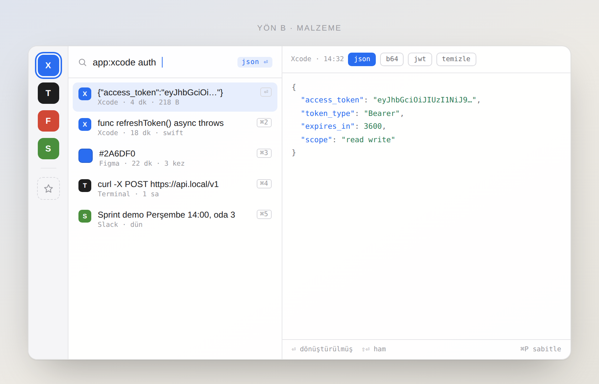
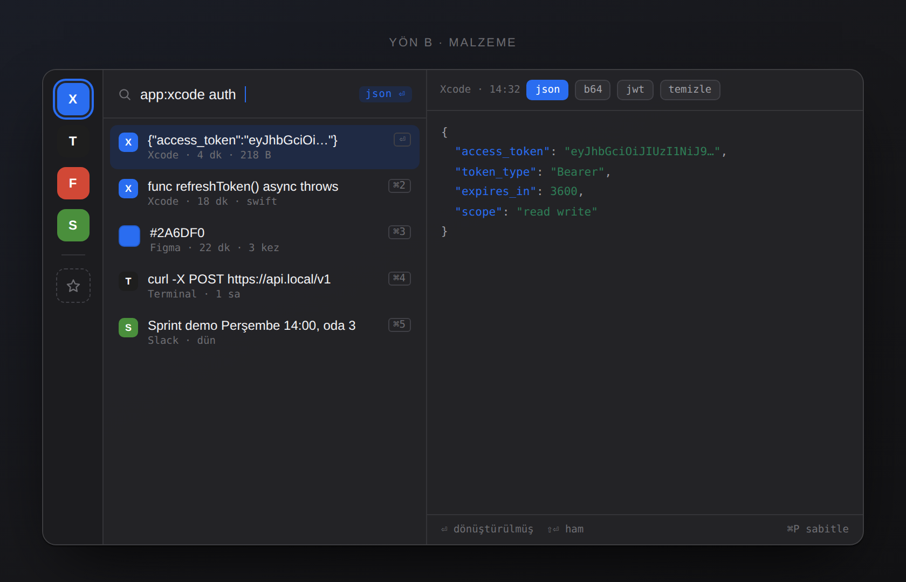

# Design

The chosen direction is **B — Material**.





The canvas with all three directions, the artboard sources and the other renders
are in `../../design/` at the project root, outside this repo.

## Principles

1. **Keyboard first, mouse second.** The cursor is in the search field the moment
   the panel opens. No function is reachable only by mouse.
2. **Three zones, one window.** Source-app rail, result list, live preview. List
   and preview are visible at the same time so "pick, look, decide" finishes in
   one glance.
3. **Speed beats decoration.** 140 ms open, no staggered row animation. Delayed
   beauty is worse than immediate plainness.
4. **The accent colour is spent in one place** — the selected row and the active
   transform chip. Identity elsewhere is carried by the source app's own icon.
5. **Lean on macOS.** System vibrancy, system font, standard materials. Do not
   invent a visual language; there is no budget to maintain one.
6. **Do not copy Paste.** Their signature is a full-width horizontal card
   carousel pinned to the bottom of the screen. Pano is a compact panel near the
   cursor. Keep it that way, for differentiation and for trade dress.

## Two additions from direction C

Agreed when B was chosen:

- Age and size in the row's metadata line
- A status bar along the bottom: `12,481 items · 42.6 MB · local`. It restates
  the privacy claim at every glance and costs nothing.

## Panel geometry

| | |
|---|---|
| Window | 760 × 440 pt, corner radius 13 |
| Rail | 56 pt fixed |
| List | 300 pt fixed |
| Preview | fills the rest |
| Search row | 44 pt tall, 13 pt horizontal padding |
| Row | 7 pt vertical padding, 8 pt horizontal, 7 pt corner radius, 2 pt gap |
| App icon in rail | 30 × 30, radius 8 |
| Type dot / swatch in a row | 18 × 18, radius 5 |
| Status bar | 24 pt |

Selected row: accent-tinted fill, no border, no left bar. Selected rail icon:
2 pt window-coloured ring, then a 2 pt accent ring.

## Type

System font throughout — `-apple-system` / SF Pro. Monospace is SF Mono, falling
back to Menlo.

| Role | Size | Weight |
|---|---|---|
| Row content | 12 | regular |
| Row metadata | 9.5 | regular, monospace |
| Search field | 13 | regular |
| Preview body | 10.5 | regular, monospace |
| Chips and keyboard hints | 9.5 | regular, monospace |
| Settings body | 13 | regular |

## Colour

Accent `#2A6DF0`. Semantic colours are separate from it and are never used as a
second accent.

| Token | Light | Dark |
|---|---|---|
| Window | `rgba(255,255,255,.96)` | `rgba(36,36,39,.97)` |
| Rail | `rgba(244,244,246,.92)` | `rgba(28,28,31,.94)` |
| Text primary | `#1D1D1F` | `#F2F2F4` |
| Text secondary | `#6E6E73` | `#A0A0A6` |
| Text tertiary | `#9B9BA1` | `#6E6E73` |
| Separator | `#E6E6E9` | `#343438` |
| Accent tint | `#E7EEFD` | `#1F2A44` |
| Chip surface | `#FFFFFF` | `#2E2E32` |
| Chip border | `#D9D9DE` | `#404046` |

Prefer the semantic `NSColor` equivalents where one exists — the table is the
intent, not a licence to hardcode. Both themes are first class; dark is not an
inversion of light and gets its own pass.

## Row anatomy

```
[18pt icon or swatch]  content, single line, truncated at the tail   [key hint]
                       source · age · size · copy count
```

- Colour items show a swatch instead of an app icon, with the hex as the content
- Masked items render dots and a "not stored" metadata line
- Code items show the detected language in the metadata line
- Images show a thumbnail in place of the icon and their OCR excerpt as content

## Preview

Header strip: source and time on the left, transform chips to the right. The
active chip is filled with the accent; the rest are outlined.

Body depends on kind. Code gets syntax highlighting. A colour gets a large
swatch plus the format list (hex, rgb, hsl, SwiftUI, Tailwind), each row
selectable and pasteable on its own. Images get the image plus the OCR text.

Footer: `⏎ paste transformed · ⇧⏎ raw · ⌘P pin`.

## Motion

- Panel open: 140 ms, slight scale from 0.98, opacity 0 → 1
- Panel close: 100 ms, no scale
- Selection: no animation. Instant.
- Transform switch: cross-fade the preview body over 90 ms
- Honour `NSWorkspace.shared.accessibilityDisplayShouldReduceMotion` — with it on,
  every duration is zero

## Empty and error states

Do not ship a blank rectangle. Each of these needs a designed state:

- First run, before permission
- Permission granted, history still empty
- Search with no results
- Pasteboard access denied
- A pinboard with nothing in it
- Database failed to open

## Accessibility

Every control gets a label as it is written, not in a cleanup pass. VoiceOver
must be able to move through the rail, list and preview in a sensible order. The
keyboard already reaches everything by design, which does most of the work. Test
with Increase Contrast and with Reduce Motion on.
